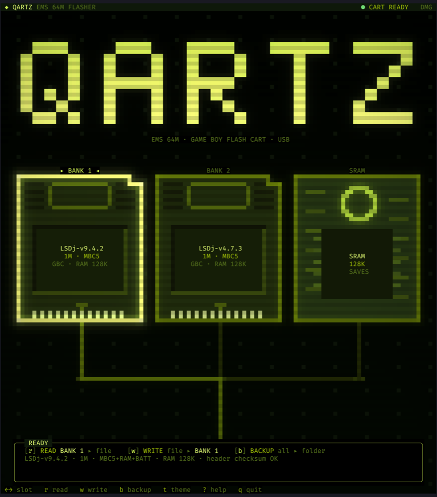
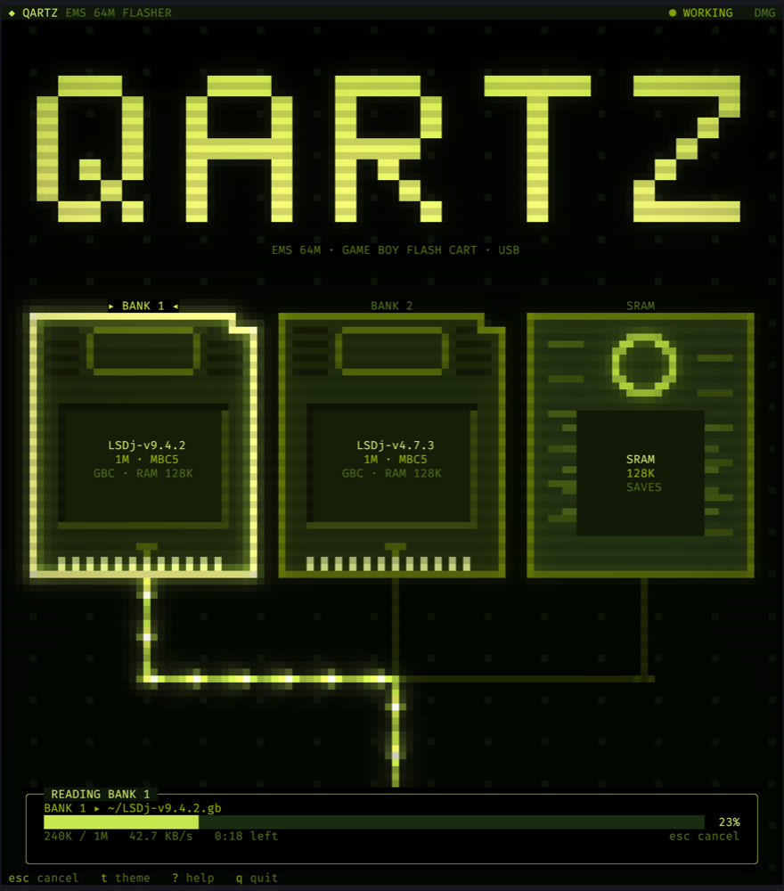
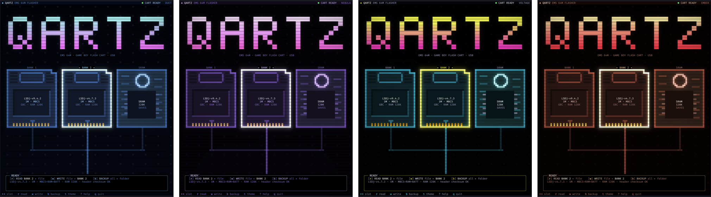
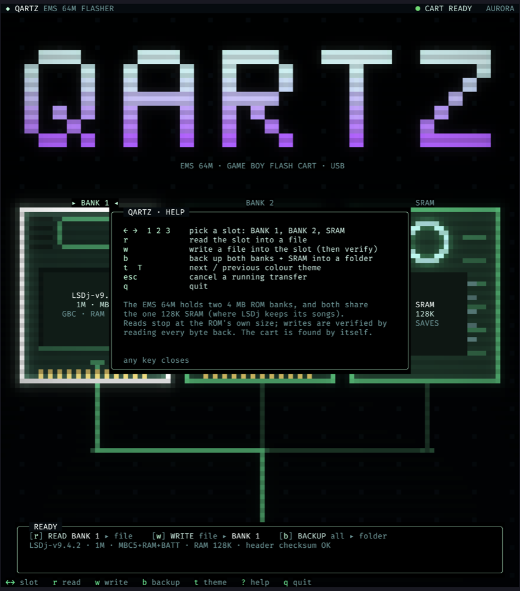

# qartz

**Flash EMS 64M USB Game Boy carts from the terminal** - a 60 fps neon pixel-art TUI and a scriptable CLI,
written in Zig on the [movy](https://github.com/M64GitHub/movy) terminal engine. A from-scratch port of
[ems-qart](https://github.com/rbino/ems-qart).

<p align="center">
  
  
</p>

## What it does

- **Three slots - BANK 1, BANK 2, SRAM.** Read any of them into a file, write a file into any of them.
  The labels show what the cart really holds: title, size, mapper, GBC flag, RAM.
- **Every write is verified** by reading it all back; every ROM read is checked against the ROM's own
  global checksum.
- **Backup** dumps both banks and the SRAM into one folder, files named after the ROM titles.
- **Hotplug**: the cart is picked up the moment it's plugged in (USB hubs are fine) — the slots power on
  left to right. No refresh button.
- **Safe cancels**: `esc` cancels a transfer (a write asks twice — it leaves the bank half-flashed).
  Closing the window or Ctrl+C finishes the USB block in flight first, so the cart is never left hanging.
- **USB timeouts**: a pulled cable fails the job instead of freezing the app.
- **Fuzzy file picker** with favorites, a confirm screen that shows the file's header next to what the bank
  holds now, and **11 colour themes** with crossfade — `t` cycles them, DMG green by default.

<p align="center">
  
  <br><sub>DUET · NEBULA · VOLTAGE · EMBER — four of the eleven</sub>
</p>

## Install (macOS)

One universal binary for Apple Silicon and Intel, macOS 13 or newer, no dependencies (libusb is built in):

```sh
curl -L https://github.com/M64GitHub/qartz/releases/latest/download/qartz-macos-universal.tar.gz | tar xz
mv qartz-*-macos-universal/qartz /usr/local/bin/      # or anywhere on your PATH
qartz
```

Downloaded it with a browser instead? macOS quarantines files from the web, and qartz is not notarized
(it's ad-hoc signed): clear the flag once with `xattr -d com.apple.quarantine qartz`. `curl` doesn't set it.

## Build

Needs [Zig 0.15.2](https://ziglang.org/download/) — on macOS that's all (libusb is compiled in from source);
on Linux also `libusb-1.0-0-dev` and `pkg-config`.

```sh
zig build                        # ReleaseFast by default -> zig-out/bin/qartz
zig build test                   # unit tests
tools/release-macos.sh           # the universal release tarball
```

movy and libusb are fetched by `zig build` (pinned in `build.zig.zon`). No driver is needed on macOS. On
Linux, give your user access to the cart (USB `4670:9394`) with a udev rule like ems-qart's
`50_ems_gb_flash.rules`.

## Use



```sh
qartz                            # the app
qartz info                       # cart status + both banks
qartz read rom <1|2> <file.gb>   # dump a bank
qartz read sram <file.sav>       # dump the save RAM
qartz write rom <1|2> <file.gb>  # flash + verify
qartz write sram <file.sav>      # write + verify
qartz backup <dir>               # everything
```

| key | |
|---|---|
| `←` `→` `1` `2` `3` | pick a slot |
| `r` / `w` | read / write the slot |
| `b` | back up everything |
| `t` / `T` | next / previous theme |
| `esc` | cancel a transfer |
| `?` / `q` | help / quit |

Any terminal with truecolor works (at least 80×24); qartz is developed in [kitty](https://sw.kovidgoyal.net/kitty/).

<br clear="right">

## No hardware? The fake cart

`--fake <dir>` swaps the USB cart for one kept in a directory (`rom.bin` holds both banks, `sram.bin` the
save RAM). It answers at the real cart's measured pace (`--fake-speed 0` = instant), and touching
`<dir>/unplugged` pulls its cable. Everything — app and CLI — works against it.

## Headless (tests, screenshots)

```sh
qartz --fake /tmp/cart --dump-screen --size 90x26 --frames 120 --keys "20:w,40:text=lsdj,60:enter"
qartz --fake /tmp/cart --shot out.png --frames 60 --motion
```

`--dump-screen` prints the text layer, `--shot` saves the pixel layer, `--keys` scripts `frame:key` presses.
`QARTZ_CONFIG=<file>` keeps a test run away from `~/.config/qartz/config.zon`.

## Troubleshooting

**"cart found but not answering"** - the cart's firmware hangs if a host dies in the middle of a transfer
(a killed process, a crash). It then ignores even basic USB requests until it loses power: unplug the
cart itself for a few seconds. qartz never leaves it that way on a normal quit, `esc`, Ctrl+C or a closed
window.

## Measured

On an EMS 64M through a USB hub (macOS 26, Apple Silicon): a 1 MB ROM reads in ~24 s (~43 KB/s), the
128 KB SRAM in ~5 s. The firmware answers 4 KB reads and 32-byte writes, as in ems-flasher.

## Credits

The USB protocol comes from [ems-qart](https://github.com/rbino/ems-qart) by Riccardo Binetti, who took it
from [ems-flasher](http://lacklustre.net/projects/ems-flasher/) by Mike Ryan. The file dialog, form kit, text
canvas, themes and terminal presenter come from DUET, a tracker built on movy; the pixel/glow core is
movy's `Frame`. macOS builds statically link [libusb](https://libusb.info) (LGPL-2.1-or-later).

## License

GPL-3.0-or-later, like ems-qart, whose protocol code it ports. See [LICENSE](LICENSE).
